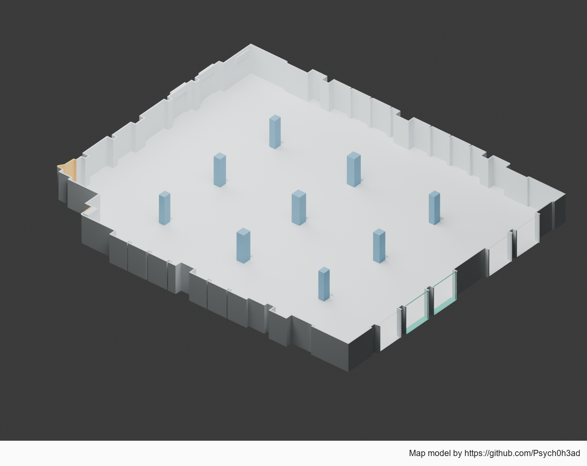
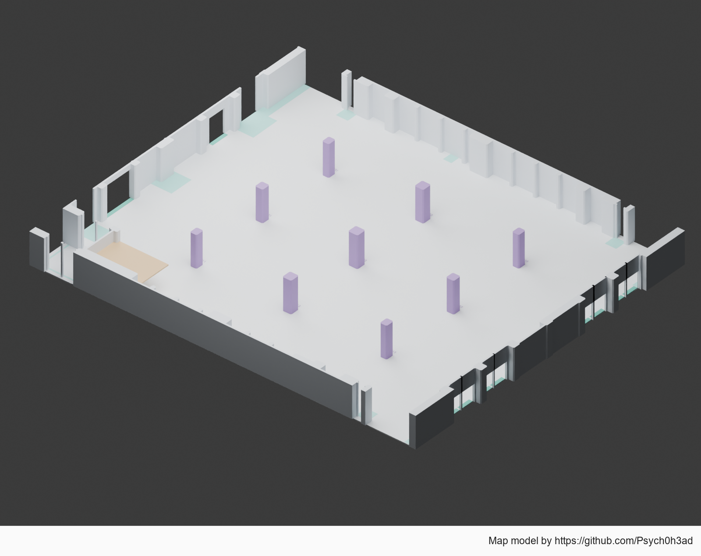
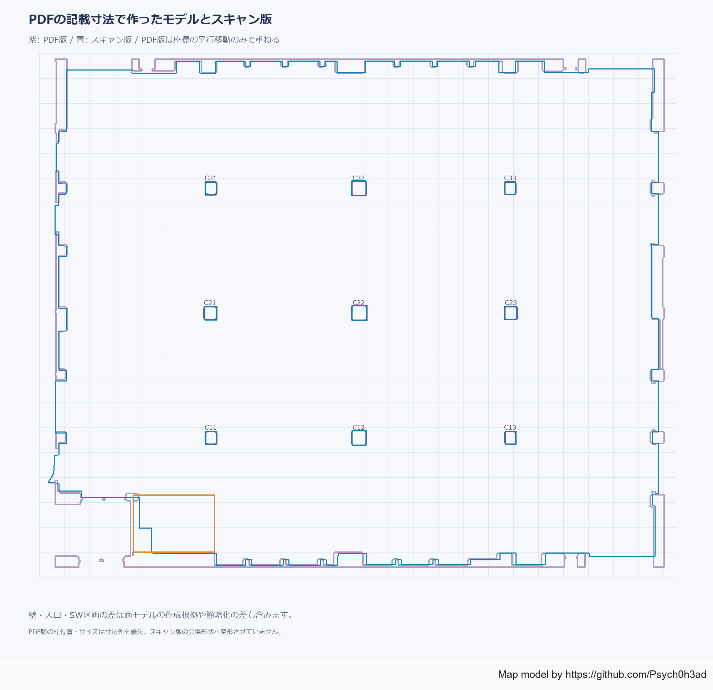

# JRRF / TRC Eホール 会場モデル

イベント主催者のために、東京流通センター（TRC）第二展示場Eホールを配置検討用の軽量3Dモデルにしました。ブース・机・通路などの配置設計、会場マップやパンフレットの作成に使ってください。

**公開の目的は、図面の縮尺や図形と記載寸法の不整合によって、イベント主催者や出展者が配置計画で不利益を被ることを減らすことです。** 今回確認した設備図には、表示された縮尺と図形の大きさが一致しない部分がありました。判断の根拠とモデルの未確定部分を示し、計画に使えるデータを共有します。

**寸法・精度・現状との一致は保証しません。** 利用によって生じた損害について、法令上免責が認められる範囲で責任を負いません。確定寸法が必要な箇所は現地計測・会場確認を行ってください。



## ダウンロード

[最新版の配布ページ](https://github.com/Psych0h3ad/jrrf-venue-models/releases/latest)からZIPを取得してください。各ZIPにはモデル、説明、利用条件、クレジットを収録しています。

| 配布データ | 作り方 | 主な内容 |
| --- | --- | --- |
| [スキャン由来版 ZIP](https://github.com/Psych0h3ad/jrrf-venue-models/releases/download/v1.1.0/JRRF_scan_model_v1.1.0.zip) | 公開ビューア用メッシュの縮尺を維持 | 床・壁・9本の柱・入口区画・上部張り出し |
| [PDF記載寸法版 ZIP](https://github.com/Psych0h3ad/jrrf-venue-models/releases/download/v1.1.0/JRRF_PDF_dimensioned_model_v1.1.0.zip) | 図面の寸法列から位置・形状を再構築 | 床・壁・9本の柱・開口・低い天井・設備配置範囲 |
| [比較資料 ZIP](https://github.com/Psych0h3ad/jrrf-venue-models/releases/download/v1.1.0/JRRF_comparison_v1.1.0.zip) | PDFの縮尺・記載寸法とスキャン由来モデルを比較 | 日本語PDFレポート・比較図・CSV・数値JSON |

各モデルは **STEP / FCStd / Blender / GLB / OBJ+MTL / DXF / JSON / CSV** で配布しています。個別ファイルは [models/scan](models/scan) と [models/pdf](models/pdf) からも取得できます。

STEP単体は配布ページ、または [スキャン版STEP](models/scan/JRRF_venue_layout.step) / [PDF版STEP](models/pdf/JRRF_PDF_venue.step) から取得できます。STEP・FCStdは通常のBREPソリッド、Blender・GLB・OBJはポリゴンメッシュです。ネイティブCADファイルは形状を保持した複数ソリッドのモデルで、元の設計履歴を復元したものではありません。

## 単位と使い方

- Blender・OBJ・JSON・CSVは **メートル**。GLBはメートル / Y-up、Blender・OBJはZ-upです。
- DXFは **ミリメートル**。PNGの見た目や印刷倍率から寸法を取らず、DXFまたは3Dモデルを使ってください。
- STEP（AP214）のファイル内の長さ単位は **メートル**。CADでの表示単位がmmでも、47.520mが47,520mmになる同じ実寸です。FCStdの内部単位はミリメートルです。物理的な座標と原点は同じです。
- 両モデルは比較しやすい同じ座標に置いてあります。PDF版は平行移動のみで合わせており、スキャンに合わせた寸法変更や回転はしていません。
- Blenderでは床・壁・柱などをコレクションで切り替えられます。PDF版の `10_Scan_model_reference_hidden` には、比較用の軽量なスキャン由来モデルを非表示で収録しています。

詳細は [スキャン版の説明](docs/scan-model.txt)、[PDF版の説明](docs/pdf-model.txt)を参照してください。

## 比較で分かったこと

対象は [TRC Eホール設備図 2025/12版](https://www.trc-event.jp/download/pdf/setsubi_e.pdf)です。2026-10-01取得時点のファイルを比較しました。

| 確認項目 | 結果 |
| --- | --- |
| 幅47.520mの寸法線を「1/250」で換算 | 約52.122mになる |
| 横2mグリッドを「1/250」で換算 | 約2.201mになる |
| 同じ図面の10mスケールバー | 「1/250」で約10.000mになる |
| スキャン由来モデルの代表的な壁間 | 約47.527m |
| 天井高 | PDF記載4.000m / スキャン当てはめ約3.992m |

平面図の主要図形を「1/250」で測ると約10%大きく読みますが、スケールバーはその縮尺と整合しています。**図形・縮尺・スケールバーが同じ倍率でそろっていない**ことが問題です。PDF版は単に全体を縮小するのではなく、主要寸法47.520×40.380mと柱・開口の記載寸法を優先して作り直しました。局所的な図形の不整合もあるため、単一の補正倍率だけで全箇所が直るとはしていません。

寸法列から作り直したPDF版とスキャン版の柱中心差は、平行移動のみで合わせた場合、9本中最大約62.0mmです。比較レポートにある最大122.3mmは、**元PDFの柱図形の外接矩形中心**との比較であり、作り直したPDF版との比較とは測り方が違います。いずれも現地に対する誤差保証ではありません。




[比較資料と詳しい数値](docs/comparison/)には、3ページの日本語レポートと比較データを収録しています。公式の賃貸面積とモデル輪郭面積は定義をそろえていないため、面積差をPDFの誤りの証拠にはしていません。

## 未確定の部分・検証

スキャン版は、公開ビューア用の表示メッシュを整理したモデルです。計測機器の元点群ではありません。ガラス・扉の有効開口、西側の隅・南側切欠き・南西の床境界などに補間・暫定部分があり、橙色などで区別しています。壁際の設備を保守的に障害物として扱う部分もあります。

PDF版は、記載寸法がない壁厚・凹凸・柱の面取りなどに図形からの推定を含みます。扉記号のW/Hの適用や南西のアクセス区画の解釈は暫定です。薄緑の床面は図面に示された防災設備配置範囲です。設備や会場ルールの最新状況は会場に確認してください。

保存後のBlender再読み込み、柱寸法、主要寸法、閉じた形状、GLB/OBJの寸法保持を確認しました。配布対象の部品はスキャン版41個、PDF版88個です。検証データは各モデルのフォルダにあります。元メッシュに対する局所平面フィット残差や標本最大値は、実空間に対する精度保証・連続面全体の誤差上限ではありません。

v1.1.0のSTEPは、各部品の輪郭を押し出して再構築しました。三角形を個別のCAD面にした変換ではありません。スキャン版は41ソリッド・776面、PDF版は88ソリッド・1,274面で、全て解析的な平面です。柱・壁の凹凸・柱の面取り・開口枠・低い天井など、既存モデルの形状を保持しています。PDF版の設備配置範囲も別ソリッドで含みます。

STEP再読み込み後の形状妥当性、部品ごとの寸法・体積、頂点・三角形中心・辺の中点・面サンプルによる双方向比較を確認しました。元の再構築済みGLBとの標本最大差は、スキャン版約0.0011mm、PDF版約0.0036mmです。この値は変換前後の一致度で、会場の実測精度ではありません。CAD面を三角形化した検証用メッシュの数値丸めも含み、連続面全体の保証上限ではありません。

## 利用条件・必須クレジット

**クレジットを分かりやすく明記することを条件に、利用・改変・再配布できます。商用・非商用を問いません。** 詳細は独自利用条件の [LICENSE](LICENSE) を参照してください。

パンフレット、会場マップ、配置図など、このモデルを利用して作成・公開・配布する図版には、**図版の隅に、通常の閲覧サイズで読めるように**次の表記を入れてください。

```text
Map model by https://github.com/Psych0h3ad
```

モデル・座標・寸法データを使った場合も、README、Credits、同梱説明、利用画面など、利用者が確認できる場所に同じクレジットを記載してください。データを改変・再配布する場合は、クレジットと利用条件を引き継いでください。

本利用条件はPsych0h3adによる再構築・編集部分に適用します。元スキャン、公式図面、比較資料中の原図引用部分など、第三者の資料の権利を新たに許諾するものではありません。

## 出典・クレジット

- 公開スキャン：**3DMart Japan / Japan RepRap Festival / Realsee** — [会場3Dビューア](https://realsee.ai/VbOOJVjA)
- スキャン紹介：[JRRF公式サイト](https://japanreprapfestival.com/) / [3DMart Japanのイベントレポート](https://www.3dmart.co.jp/blogs/news/rep-rap-2026-review)
- 設備図：**株式会社東京流通センター（TRC）** — [公式ダウンロード](https://www.trc-event.jp/download/) / [Eホール設備図](https://www.trc-event.jp/download/pdf/setsubi_e.pdf)
- モデル再構築・編集：**[Psych0h3ad](https://github.com/Psych0h3ad)**

配布モデルには元の表示スキャンメッシュ・パノラマ写真・公式PDF本体・Blender内の公式PDF画像を収録していません。比較資料には検証のための原図の限定的な図形引用と出典を含みます。詳細は [THIRD_PARTY_NOTICES.md](THIRD_PARTY_NOTICES.md) を参照してください。会場や資料提供者による公式モデル・精度認証を示すものではありません。

## 問題の連絡・テイクダウン

配布データの権利、内容、公開方法などに問題がある場合は、**[info@psych0h3ad.tech](mailto:info@psych0h3ad.tech)** へご連絡ください。対象ファイル・問題の箇所・理由を確認し、必要に応じて修正、配布停止、削除（テイクダウン）に対応します。確認中に該当データを一時的に非公開にする場合もあります。

本公開は、縮尺の不整合による不利益を減らし、イベントの配置検討を助けることを目的としています。問題のあるデータを公開し続けることを目的とするものではありません。

## スキャン・モデリングの依頼

会場のスキャン、配置設計用モデルの作成などの案件があれば、**[info@psych0h3ad.tech](mailto:info@psych0h3ad.tech)** へお問い合わせください。
